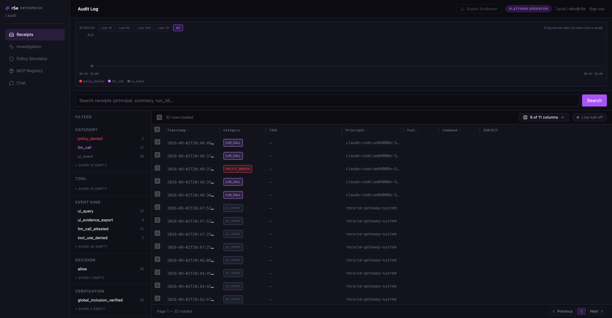

# r5e-enterprise

r5e is a governance gateway for AI coding agents. Its supported LLM proxy admits model requests through r5e-kernel before contacting the provider and admits tool intents before releasing their executable bytes. Cedar policy, request signatures, evidence objects, and admission decisions are bound into the kernel's append-only chain. An export can be checked offline using r5e-core's verifier.

This is the coordinated OSS release candidate. Core, kernel, and enterprise are required parts of one source distribution; the candidate has not yet been published upstream.


The compose stack in this repository shows how the system works and that it works. It is not a deployment; [deployment shapes](docs/deployment-shapes.md) says what a deployment adds.

## Quickstart

Docker with Compose v2, Claude Code signed in, `curl`, `jq`, `unzip`, `openssl`, and `xxd`; `cargo` only for the legacy `bin/r5e evidence verify` path. Start in an extracted coordinated source archive: it contains `repos.lock.json` beside `r5e-core`, `r5e-kernel`, and `r5e-enterprise`.

```
cd r5e-enterprise
export R5E_BUILD_CONTEXT="$(cd .. && pwd)"
bin/r5e init
docker compose up -d
bin/r5e login
bin/r5e claude-code setup
```

The first `docker compose up -d` builds the extracted snapshot. For development from three sibling **JJ checkouts**, use Python 3.12+ and `python3 scripts/prepare-release.py` instead of the export above; Compose then uses `.release-context`. See [version pins](docs/version-pins.md) for exact revisions. The stack publishes ports 4000 and 4443 on loopback; if either is taken, set `R5E_GATEWAY_PORT` or `R5E_PROXY_PORT` in `.env`. Docker volumes are keyed by the compose project name `r5e`; choose a separate project name, distinct ports and a distinct `R5E_GATEWAY_CONTAINER` when running another stack. Keep the `kernel` volume: it holds the admission history and signing keys.

Point Claude Code at the gateway with the two exports the last command prints, then use it as usual. [The quickstart](docs/quickstart-claude-code.md) walks through a first prompt, a denied `rm -rf`, a policy change, and an offline verification, with the expected output at each step.

The kernel chain is the authoritative admission evidence. The audit console still presents the enterprise ledger projection; its older receipt export has a different format and verifier. See [the release contract](docs/release/oss-release-contract.md) for the supported boundary and [fold evidence](docs/fold-evidence.md) for chain export.

The older chat-completions, audit-agent chat, and MCP tool-execution endpoints return `503 capability_unavailable` until they use the same admission boundary. LLM suggestion generation is also unavailable; heuristic suggestions and audit reads remain. See the [execution inventory](docs/release/execution-surfaces.md).

## Documentation

| Type | Page |
|---|---|
| Tutorial | [Quickstart with Claude Code](docs/quickstart-claude-code.md) |
| How-to | [Policy from a git repository](docs/policy-from-git.md) |
| How-to | [The fold's evidence path](docs/fold-evidence.md) |
| Reference | [Environment variables](docs/reference/env.md) |
| Explanation | [Architecture](docs/architecture.md) |
| Explanation | [What a receipt proves](docs/what-a-receipt-proves.md) |
| Explanation | [Deployment shapes](docs/deployment-shapes.md) |
| Explanation | [Version pins](docs/version-pins.md) |
| Explanation | [Codex and other clients](docs/codex-and-other-clients.md) |

## Limitations

- One tenant and one fixed local identity; sign-in is a dev login the compose file enables.
- Cleartext HTTP on loopback and the compose network; the gateway forwards the credential Claude Code sends and stores none.
- Claude Code is the supported client. The Codex path is an appendix, last validated outside this stack.

## License

Copyright (c) 2026 r5e Inc. Licensed `AGPL-3.0-only` — GNU Affero General Public License,
version 3, full text in [LICENSE](LICENSE), scope and the two exceptions in
[LICENSE.md](LICENSE.md). Third-party components: [THIRD_PARTY_NOTICES.md](THIRD_PARTY_NOTICES.md).
Canonical repository: [gitlab.com/r5e-group/r5e-enterprise](https://gitlab.com/r5e-group/r5e-enterprise).

[Contributing](CONTRIBUTING.md) · [Security](SECURITY.md) · [Code of conduct](CODE_OF_CONDUCT.md)

## Steward keys

Releases of this repository are signed by the steward, r5e Inc., with keys held on hardware.

- **Root key** (signs the release freight, and later governance acts on the public chain): `key:ed25519:sha256:aeb2f4f7d81d87ce8e9f437fa5bada43d41d7cf5badcceffdf37403ddfee53fc`
- **Release signing key** (signs tags; a device key, not the root): `sk-ssh-ed25519@openssh.com AAAAGnNrLXNzaC1lZDI1NTE5QG9wZW5zc2guY29tAAAAIBtRc8IONTDUOq5HioZEa1qpH9XT4z80VM0tcdJ8lSImAAAAD3NzaDpyNWUtcmVsZWFzZQ== Thomas Jones (gitlab.com)`

To check a tag: put the line `thomas@runr5e.ai namespaces="git" sk-ssh-ed25519@openssh.com AAAAGnNrLXNzaC1lZDI1NTE5QG9wZW5zc2guY29tAAAAIBtRc8IONTDUOq5HioZEa1qpH9XT4z80VM0tcdJ8lSImAAAAD3NzaDpyNWUtcmVsZWFzZQ== Thomas Jones (gitlab.com)` in a file, then `git -c gpg.format=ssh -c gpg.ssh.allowedSignersFile=<that file> tag -v v0.1.0`. To check a release's freight: download `freight.dsse.json` and `verify-freight.py` from the release and run `python3 verify-freight.py freight.dsse.json key:ed25519:sha256:aeb2f4f7d81d87ce8e9f437fa5bada43d41d7cf5badcceffdf37403ddfee53fc` (needs the `cryptography` package). The freight for v0.1.0 is `bytes:sha256:7c9d09d5128ba090ff339455db150091fd6fd7b2dbf1ce1e9e2297831ae288fd`.
