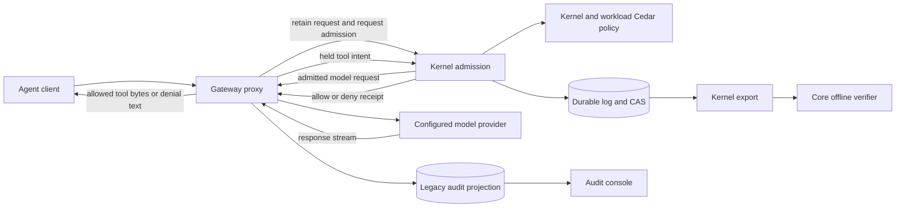

# Architecture

For the operator of the local standalone release. The [execution inventory](release/execution-surfaces.md) identifies the exposed routes and their limits.

## Request and response path

Claude Code uses the proxy address in `ANTHROPIC_BASE_URL`. The local stack exposes its proxy and audit listeners on loopback. The proxy forwards the client's provider credential to the configured upstream; that credential is not used as the fold's signing identity.

Before sending model request bytes, the gateway retains the request and obtains a kernel admission. It holds executable tool frames until the corresponding ToolCall is admitted. The kernel evaluates policy; the proxy enforces its receipt without a second independent authorization decision.

For supported Anthropic responses, an allowed tool block is released and a denied block is replaced with explanatory text. Admission errors, parser failure, unsupported executable formats and incomplete frames interrupt the response and suppress terminal success. A policy denial and a broken admission service are distinct outcomes.

Every WebSocket model request opens its own admission. Policy changes apply at each new admission, so the model opening and a later tool can cite different policy versions. Earlier receipts remain bound to the versions they actually used.

## Policy and persistence

Core defines the protocol and offline checks. The kernel implements admission, durable storage, authority and policy jurisdiction. Enterprise's fold defines the gateway Kinds and signs observations using its delegated service key.

Kernel-owned policy governs evidence, authority, vocabulary and policy maintenance. Workload policy governs model and tool requests. Filesystem or OCI policy activation must be admitted before its local projection becomes visible. Rejected activation retains the previous admitted policy.

The kernel volume holds history, CAS and signing keys. CAS persistence precedes log acknowledgement, and startup refuses corrupt history or missing payloads needed for authoritative replay. A restarted writer must retain its original signing identity.

## Evidence and console

The kernel chain is authoritative for admission. Completion records link to the opening and actual tool decisions without re-admitting them. Interrupted outcomes remain distinct; missing or partial response evidence does not imply a successful model response.

The console presents the older enterprise ledger projection. Its signed receipts, Merkle proofs and export zip remain a separate format. Legacy payload-retention settings affect that projection; they cannot disable mandatory kernel request evidence.

An offline reader exports the kernel chain and invokes core's verifier independently of the writer. See [fold evidence](fold-evidence.md) for the commands and [receipt evidence](what-a-receipt-proves.md) for the distinction between a recorded statement and the external event it describes.
